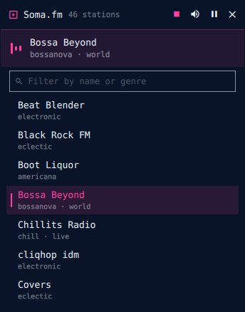
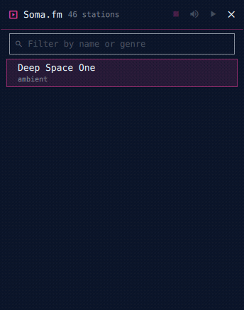

# Soma.fm for Omarchy

[](https://github.com/sponsors/joshuaswarren)

Listen to [Soma.fm](https://somafm.com) in a small Omarchy shell window.
Browse its live station list, filter by name or genre, and control playback
with the keyboard. Audio continues when the panel is hidden.





## Install

```sh
omarchy plugin add https://github.com/joshuaswarren/omarchy-somafm --enable
```

The plugin needs Omarchy's shell, QtMultimedia for audio, and `curl` for the
station list and playlists. It does not need a separate player.

## Use

Click the Soma bar button or use the command palette to open the panel.
Type in the filter box to narrow stations. Click a station to play it;
clicking it again restarts it.

| Key | Action |
|---|---|
| `Up` / `Down` | Move selection |
| `PgUp` / `PgDn` | Move eight stations |
| `Home` / `End` | First / last station |
| `Enter` | Play selection |
| `Space` | Pause / resume while the station list has focus |
| `Esc` | In the filter input, clear the filter; if already empty, hide the panel |

The header has stop, mute, pause/resume and hide buttons. Hiding leaves
audio playing. Drag the header to move the panel. System volume keys and
the audio widget control the stream's volume.

To open a station directly, pass its catalog ID:

```sh
omarchy-shell shell summon io.github.joshuaswarren.somafm '{"station":"groovesalad"}'
```

The station starts playing after the catalog loads. The catalog changes
over time; this plugin does not promise a fixed station count.

## Update and remove

```sh
omarchy plugin update io.github.joshuaswarren.somafm
omarchy plugin remove io.github.joshuaswarren.somafm
```

To enable an already installed copy:

```sh
omarchy plugin enable io.github.joshuaswarren.somafm
```

## State and network access

The plugin saves window position in
`${XDG_STATE_HOME:-~/.local/state}/somafm/window.json`. There is no saved
queue, favourites list or listening-history file. Audio can continue while
the session is locked; the panel hides on lock.

Catalog and playlist requests use HTTPS-only Soma.fm URLs, with redirect
checks, timeouts and transfer-size limits. Playback needs a network
connection. See [requirements](docs/REQUIREMENTS.md) for implementation limits.

## Support

[Sponsor this plugin](https://github.com/sponsors/joshuaswarren) or use
Lightning at `joshuaswarren@strike.me`.

Soma.fm is listener-supported. Consider [supporting the station](https://somafm.com/support/)
if you listen regularly.

## License

MIT. See [LICENSE](LICENSE).
